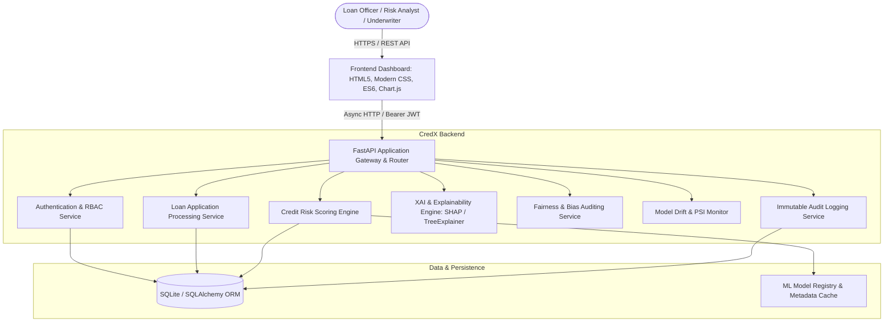

# SYSTEM ARCHITECTURE & TECHNICAL DESIGN
## CredX AI — Explainable Credit Risk Platform

**Document ID:** ARCH-001  
**Version:** 1.0.0  

---

### 1. High-Level Architecture (C4 Model - System Context)

---

### 2. Component Architecture

1. **Presentation Layer (Frontend)**:
   - Modern Glassmorphism & High-Contrast Finance Theme.
   - Dynamic Views:
     - **Executive Overview**: Total applications, approval rate, portfolio default probability, risk tier distribution chart.
     - **Loan Applications Pipeline**: Filterable table with status badges (`Under Review`, `Approved`, `Rejected`, `Escalated`).
     - **New Application Modal & Form**: Real-time client-side financial ratio calculation.
     - **Deep-Dive Applicant Profile & Explainability View**:
       - Gauge chart: Credit Risk Score (300-850) & Default Probability (0-100%).
       - SHAP Waterfall Breakdown: Visualizing top risk drivers (positive and negative attributions).
       - Human-Readable Adverse Action Generator.
       - Interactive "What-If" Counterfactual Simulator.
       - Underwriter Decision & Override panel.
     - **Fairness & Bias Audit Panel**: Disparate impact ratio, demographic parity by age group.
     - **Model Performance & Drift Monitor**: ROC-AUC, Brier score, PSI drift indicator.
     - **System Audit Log Viewer**: Complete trail of actions.

2. **API & Service Layer (FastAPI)**:
   - Modular routers with dependency injection (`api/auth.py`, `api/applications.py`, `api/assessment.py`, etc.).
   - Pydantic v2 schemas for strict input validation, type safety, and serialization.
   - JWT tokens with SHA-256 signatures, bcrypt salted password hashing.

3. **Machine Learning & XAI Subsystem**:
   - High-performance ensemble classifier (Calibrated Random Forest / Gradient Boosting) trained on 5,000+ realistic credit records.
   - Feature Preprocessing Pipeline (standardization, one-hot encoding, feature interaction).
   - `TreeExplainer` and mathematical attribution giving exact Shapley values.
   - Fallback robust linear/additive explainer to guarantee zero runtime failures.
   - Counterfactual Engine simulating feature adjustments to find optimal path to credit approval.

4. **Persistence Layer**:
   - Relational SQLite schema with Foreign Key cascading, transaction isolation, and indexed lookups.
   - Automated database initializers with seed admin, risk analyst, and loan officer accounts, plus rich demonstration loan applications.

